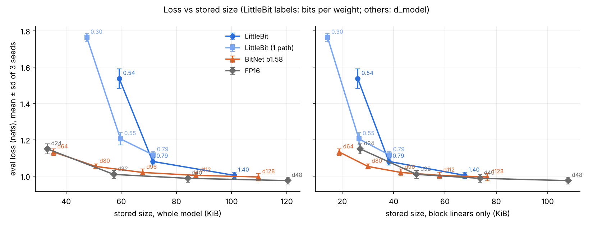

# lilbits

**A PyTorch toolkit of primitives for small, lean AI models**: models that are cheap to train *and* to run.

The repo collects interchangeable building blocks, each with tests and a dense FP reference:

- **Compressed linears:** LittleBit sub-1-bit low-rank binarized layers, and BitNet b1.58 ternary layers.
- **Token mixers:** softmax attention, and recurrent mixers with fixed-size state: Gated DeltaNet, Mamba2, GLA (RWKV-6 style), xLSTM mLSTM and minGRU.
- **Packing and inference:** 1-bit and 2-bit packed weights, inference caches, and Helion kernels.
- **Decision-model parts (Jev-style):** a state prefilled once, forks per question, and a typed Choice / Score / Noul readout with calibration metrics.
- **Training:** a Lightning Fabric loop, Muon and DeepSeek-style Muon, FP warm start → LittleBit conversion, and Optuna sweeps.
- **Measurement:** quality, stored size, RAM, peak memory, CPU time and wall time for both training and inference.

`src/` holds the primitives, `examples/` shows how to combine them, and `benchmarks/` runs examples or primitives
side by side on every dimension. `docs/primitives.md` maps the target architectures (looped LittleBit core,
sparse state index, MTP/verify, typed decision readout) to what exists and what is still missing.

It started as a prototype of LittleBit trained **from scratch** (no pretrained teacher, no distillation). The
results below come from that work. References: Lee et al., *LittleBit: Ultra Low-Bit Quantization via Latent
Factorization* (NeurIPS 2025, arXiv:2506.13771), LittleBit-2 (arXiv:2603.00042), and Ma et al., *The Era of
1-bit LLMs* (BitNet b1.58, 2024).

All numbers below come from CPU runs on a toy setup: synthetic order-2 Markov data (vocab 32, known best
possible loss ≈ 0.89-0.90 depending on seed; uniform guessing = 3.47), TinyLM with d_model 128, 2 blocks,
batch 32 × seq 64, 1,500 steps = 3.07M tokens. "Matched params" means LittleBit at 1.41 bpw, which has the
same number of trainable FP32 parameters as the FP baseline (410,256 vs 412,288).

## Results

### Best so far (mean of seeds 0-2, matched params)

| model | settings | bpw (blocks) | stored model | eval loss |
|---|---|---|---|---|
| FP16 baseline | tuned: torch Muon, 10 NS steps, lr ≈ 0.004 | 16 | 805 KiB | **0.957** |
| FP16 baseline | default: AdamW, lr 3e-3 | 16 | 805 KiB | 0.961 |
| LittleBit | tuned: 600-step FP warm start + SVD+ITQ, DeepSeek Muon, lr ≈ 0.01, latent lr ×0.02, wd 0.01 | 1.40 | **101 KiB** packed | **1.004** |
| LittleBit | default: 300-step FP warm start + SVD+ITQ, AdamW, lr 3e-3, latent lr ×0.1 | 1.40 | **101 KiB** packed | 1.023 |

LittleBit stores the block weights 11.4× smaller (8.0× for the whole model) and gets within 0.048 of the
tuned baseline's loss. Tuned settings come from the Optuna sweep below.

### Loss vs stored size: below 1 bpw, and BitNet b1.58 (`uv run python benchmarks/frontier.py`)



LittleBit stays at d_model 128 and drops bits per weight. BitNet b1.58 (ternary absmean weights, 8-bit
absmax activations, `bitnet.BitLinear`) is fixed at 1.58 bpw, so it and FP16 shrink by getting narrower.
Their widths are picked so stored sizes bracket LittleBit's. Every point is the mean of seeds 0-2 at 1,500 steps.

| model | d_model | block bpw | block linears | whole model | trainable params | eval loss (mean ± sd) |
|---|---|---|---|---|---|---|
| FP16 | 24 | 16.00 | 27.0 KiB | 33.2 KiB | 17,016 | 1.149 ± 0.028 |
| BitNet b1.58 | 64 | 1.59 | 18.8 KiB | 35.5 KiB | 105,792 | 1.132 ± 0.018 |
| LittleBit (1 path) | 128 | 0.30 | 14.3 KiB | 47.5 KiB | 59,290 | 1.763 ± 0.021 |
| BitNet b1.58 | 80 | 1.59 | 30.0 KiB | 50.8 KiB | 165,520 | 1.053 ± 0.013 |
| FP16 | 32 | 16.00 | 49.0 KiB | 57.3 KiB | 29,344 | 1.009 ± 0.022 |
| LittleBit | 128 | 0.54 | 26.0 KiB | 59.3 KiB | 81,980 | 1.537 ± 0.053 |
| LittleBit (1 path) | 128 | 0.55 | 26.5 KiB | 59.7 KiB | 155,404 | 1.205 ± 0.033 |
| BitNet b1.58 | 96 | 1.59 | 42.8 KiB | 67.8 KiB | 233,952 | 1.020 ± 0.019 |
| LittleBit | 128 | 0.79 | 38.1 KiB | 71.4 KiB | 177,312 | 1.081 ± 0.021 |
| LittleBit (1 path) | 128 | 0.79 | 38.3 KiB | 71.6 KiB | 248,680 | 1.117 ± 0.018 |
| FP16 | 40 | 16.00 | 73.8 KiB | 84.1 KiB | 43,080 | 0.988 ± 0.021 |
| BitNet b1.58 | 112 | 1.59 | 57.9 KiB | 87.0 KiB | 314,160 | 1.004 ± 0.018 |
| LittleBit | 128 | 1.40 | 67.7 KiB | 101.0 KiB | 410,256 | 1.004 ± 0.018 |
| BitNet b1.58 | 128 | 1.59 | 76.5 KiB | 109.8 KiB | 412,288 | 0.995 ± 0.021 |
| FP16 | 48 | 16.00 | 108.0 KiB | 120.5 KiB | 61,680 | 0.975 ± 0.019 |

**On this task, LittleBit loses at matched size.** Only its 1.40 bpw point is competitive:
1.004 at 101 KiB, against BitNet's 1.004 at 87 KiB and 0.995 at 110 KiB. Below 1 bpw it falls off fast.
At about 60 KiB, LittleBit at 0.55 bpw scores 1.205, while BitNet d80 at 51 KiB scores 1.053 and FP16 d32 at 57 KiB
scores 1.009. Narrow FP16 models are on or below the BitNet curve everywhere.

The reasons are specific to this scale, so this result does not contradict the paper's 7B-70B numbers:

- **Scale overhead.** Each LittleBit path stores FP16 scales for every input and output, which costs about
  16·(in+out)/(in·out) bpw. For 128×128 that is 0.25 bpw per path. At 0.55 bpw with two residual paths,
  the attention projections are left with rank 1, which is why the two-path curve collapses there.
  At 4096 width the same overhead is 0.008 bpw.
- **Rank floor.** At 0.3 bpw (single path) the ranks are 3 for attention and 11 for the MLP. At 4096×4096,
  0.1 bpw still leaves rank ~190 (one path) or ~95 per path (two).
- **The task is easy to fit narrow.** A 17k-param FP16 model already reaches 1.15. Size gets bought most
  cheaply with width, which is BitNet's and FP16's only lever.

Settings:

- LittleBit uses the Optuna winner, which was tuned at 1.41 bpw and reused unchanged at lower bpw.
  "1 path" means `residual=False`, which gives more rank for the same bits below 1 bpw.
- FP16 uses its Optuna winner, tuned at d128.
- BitNet got an 8-run lr/optimizer grid at d96 (`results/frontier/bitnet_grid.jsonl`). The best was DeepSeek
  Muon at lr 1e-2; 2e-2 was no better.
- BitNet storage is counted at log2(3) = 1.585 bits plus one FP16 scale per matrix. That is its
  information floor; practical 5-trits-per-byte packing costs 1.6 bits.
- BitNet trains with 8-bit activations, while LittleBit and FP16 use full-precision activations.

### Full comparison at matched stored size (`uv run python benchmarks/compare.py`)

> **Inference speed in this table is not a fair test of the bit methods.** FP16 uses an optimized BLAS
> matmul, while LittleBit and BitNet emulate low-bit math: packed weights are unpacked to FP32 on every call,
> then multiplied in FP32. At about 100 KiB the model also sits in cache, so the memory-bandwidth saving that makes
> bit weights fast never appears. Size-matching also makes the bit models wide and the FP16 models narrow, so
> FP16 d32 does about 16× fewer block FLOPs than any d128 model. Loss, stored size, RAM, training time and
> training memory are fair. A real speed comparison needs native low-bit kernels and a memory-bound size.

Each model trains for 1,500 steps on seed 0 in its own process, on one CPU thread, with its tuned
settings. The loss row is the 3-seed mean from the frontier sweep. "Fast path" means FP32 weights or cached
factors. "Packed" means 1-bit LittleBit signs with FP16 scales, or 2-bit BitNet codes, unpacked on every call.
On one thread, CPU time equals wall time.

| | FP16 d128 (full size) | LittleBit 1.40 bpw | BitNet d128 | BitNet d112 | FP16 d40 | LittleBit 0.79 bpw | BitNet d96 | LittleBit 0.55 bpw (1 path) | BitNet d80 | FP16 d32 |
|---|---|---|---|---|---|---|---|---|---|---|
| **Quality** |  |  |  |  |  |  |  |  |  |  |
| Eval loss, mean ± sd of 3 seeds | 0.957 ± 0.019 | 1.004 ± 0.018 | 0.995 ± 0.021 | 1.004 ± 0.018 | 0.988 ± 0.021 | 1.081 ± 0.021 | 1.020 ± 0.019 | 1.205 ± 0.033 | 1.053 ± 0.013 | 1.009 ± 0.022 |
| Eval loss, seed 0 (this run) | 0.978 | 1.025 | 1.019 | 1.024 | 1.011 | 1.103 | 1.041 | 1.231 | 1.068 | 1.034 |
| Final train loss, seed 0 | 1.014 | 1.065 | 1.060 | 1.078 | 1.053 | 1.149 | 1.069 | 1.294 | 1.103 | 1.086 |
| **Size** |  |  |  |  |  |  |  |  |  |  |
| d_model / block bpw | 128 / 16.00 | 128 / 1.40 | 128 / 1.59 | 112 / 1.59 | 40 / 16.00 | 128 / 0.79 | 96 / 1.59 | 128 / 0.55 | 80 / 1.59 | 32 / 16.00 |
| Trainable params | 412,288 | 410,256 | 412,288 | 314,160 | 43,080 | 177,312 | 233,952 | 155,404 | 165,520 | 29,344 |
| Stored block linears | 772.0 KiB | 67.7 KiB | 76.5 KiB | 57.9 KiB | 73.8 KiB | 38.1 KiB | 42.8 KiB | 26.5 KiB | 30.0 KiB | 49.0 KiB |
| Stored whole model | 805.2 KiB | 101.0 KiB | 109.8 KiB | 87.0 KiB | 84.1 KiB | 71.4 KiB | 67.8 KiB | 59.7 KiB | 50.8 KiB | 57.3 KiB |
| vs FP16 d128 (whole model) | 1.0x smaller | 8.0x smaller | 7.3x smaller | 9.3x smaller | 9.6x smaller | 11.3x smaller | 11.9x smaller | 13.5x smaller | 15.9x smaller | 14.1x smaller |
| **Training** (1,500 steps, 3.07M tokens, 1 CPU thread) |  |  |  |  |  |  |  |  |  |  |
| Optimizer | muon | muon_ds, 600 FP warm-up steps | muon_ds | muon_ds | muon | muon_ds, 600 FP warm-up steps | muon_ds | muon_ds, 600 FP warm-up steps | muon_ds | muon |
| Wall time / CPU time | 129 s / ≈ wall (1 thread) | 153 s / ≈ wall (1 thread) | 203 s / ≈ wall (1 thread) | 171 s / ≈ wall (1 thread) | 43 s / ≈ wall (1 thread) | 130 s / ≈ wall (1 thread) | 139 s / ≈ wall (1 thread) | 124 s / ≈ wall (1 thread) | 113 s / ≈ wall (1 thread) | 39 s / ≈ wall (1 thread) |
| ms per step | 86 | 102 | 136 | 114 | 29 | 86 | 92 | 82 | 76 | 26 |
| Steps / seconds to eval loss ≤ 1.1 | 450 / 39 s | 500 / 51 s | 850 / 115 s | 1000 / 114 s | 900 / 26 s | 500 / 43 s | 1100 / 102 s | 500 / 41 s | 1200 / 91 s | 1050 / 27 s |
| Peak RSS growth while training (sampled) | 98 MiB | 116 MiB | 144 MiB | 125 MiB | 44 MiB | 110 MiB | 104 MiB | 103 MiB | 93 MiB | 40 MiB |
| Weights + grads + optimizer state | 4,898.0 KiB | 4,916.2 KiB | 4,898.0 KiB | 3,739.8 KiB | 525.6 KiB | 2,184.0 KiB | 2,791.5 KiB | 1,908.1 KiB | 1,981.2 KiB | 360.5 KiB |
| **Inference, fast path** (FP32 weights / cached factors) |  |  |  |  |  |  |  |  |  |  |
| Weights in RAM | 1,610.5 KiB | 3,066.6 KiB | 3,154.5 KiB | 2,396.2 KiB | 168.3 KiB | 1,279.1 KiB | 1,777.9 KiB | 1,127.2 KiB | 1,251.6 KiB | 114.6 KiB |
| state_dict file (training format) | 1,618.0 KiB | 1,647.8 KiB | 1,618.0 KiB | 1,234.7 KiB | 175.7 KiB | 737.8 KiB | 921.4 KiB | 632.0 KiB | 654.0 KiB | 122.1 KiB |
| Batch 32×64: ms (tokens/s) | 14.6 (139,920) | 17.7 (115,822) | 37.6 (54,516) | 32.1 (63,768) | 4.8 (426,834) | 13.9 (147,573) | 22.4 (91,264) | 12.4 (165,710) | 21.6 (94,887) | 3.7 (553,384) |
| 1×64 sequence: ms | 0.80 | 1.05 | 1.78 | 1.51 | 0.34 | 0.72 | 1.30 | 0.66 | 1.25 | 0.33 |
| 1 token: ms | 0.28 | 0.36 | 0.75 | 0.72 | 0.22 | 0.31 | 0.63 | 0.31 | 0.67 | 0.24 |
| Peak RSS growth, batch 32×64 | 17.1 MiB | 14.8 MiB | 22.8 MiB | 18.3 MiB | 4.1 MiB | 15.6 MiB | 19.4 MiB | 14.8 MiB | 13.3 MiB | 3.1 MiB |
| **Inference, packed** (LittleBit: 1-bit signs; BitNet: 2-bit codes) |  |  |  |  |  |  |  |  |  |  |
| Weights in RAM | n/a | 136.7 KiB | 219.0 KiB | 187.3 KiB | n/a | 110.9 KiB | 159.9 KiB | 96.5 KiB | 135.4 KiB | n/a |
| state_dict file | n/a | 159.9 KiB | 174.6 KiB | 142.6 KiB | n/a | 134.2 KiB | 115.4 KiB | 119.5 KiB | 90.7 KiB | n/a |
| Batch 32×64: ms | n/a | 25.0 | 32.9 | 27.2 | n/a | 19.6 | 19.0 | 16.3 | 19.9 | n/a |
| 1×64 sequence: ms | n/a | 3.04 | 2.71 | 2.22 | n/a | 2.62 | 1.81 | 1.70 | 1.68 | n/a |
| 1 token: ms | n/a | 2.17 | 1.50 | 1.48 | n/a | 1.80 | 1.16 | 1.20 | 1.14 | n/a |
| Peak RSS growth, batch 32×64 | n/a | 15.3 MiB | 20.3 MiB | 19.6 MiB | n/a | 14.8 MiB | 15.4 MiB | 15.1 MiB | 12.9 MiB | n/a |

What the table shows:

- **Training.** LittleBit's time includes 600 FP warm-up steps. At matched size it trains about as fast as BitNet:
  0.79 bpw takes 130 s against 139 s for BitNet d96, and 0.55 bpw takes 124 s against 113 s for BitNet d80.
  Narrow FP16 trains 3 to 4 times faster than either, because it has far fewer FLOPs.
  Train-state memory follows the trainable parameter count. Both quantized methods keep FP32 latents while training.
- **Inference.** On the fast path, LittleBit is faster than BitNet at every matched size.
  BitNet pays for RMS norm and 8-bit activation quantization on every call.
  Packed LittleBit is slower than its fast path, because CPU unpacking costs more than the matmul at this width.
  Packed BitNet is 5-15% faster than its fast path on full batches, but about twice as slow on single tokens.
  For single-token latency, packed BitNet beats packed LittleBit (1.1-1.5 ms against 1.2-2.2 ms).
- **Memory and disk.** Packed LittleBit uses the least RAM for weights at each size tier, for example
  97 KiB against 135 KiB for BitNet d80 and 115 KiB for FP16 d32 at FP32.
  The training-format `state_dict` is several times larger than the packed one for both quantized methods.
- **Quality.** This is the frontier result again: at matched size, BitNet and narrow FP16 are ahead of LittleBit on this task.

### How the LittleBit result improved (seed 0)

| step | change | bpw | eval loss |
|---|---|---|---|
| 1 | first version: random init, AdamW, latent lr ×0.1, 253k params | 0.99 | 1.386 |
| 2 | + SVD + Joint-ITQ init | 0.99 | 1.179 |
| 3 | + 300-step FP warm start before conversion | 0.99 | 1.089 |
| 4 | raise rank to match the baseline's trainable params | 1.40 | 1.056 |
| 5 | Optuna-tuned optimizer settings | 1.40 | 1.021 |

FP16 baseline on seed 0: 0.984 default, 0.978 tuned.

### Full comparison at matched params (seed 0, default settings, weight decay 0)

`uv run python benchmarks/bench.py --bpw 1.41`; configs run one after another, 1 CPU thread. Saved as
`results/bench_d128_matched_params_wd0.json`.

| metric | FP16 baseline | LittleBit, SVD+ITQ init (pure from scratch) | LittleBit, 300-step FP warm start + SVD+ITQ |
|---|---|---|---|
| Final eval loss (floor 0.895) | **0.984** | 1.146 | 1.056 |
| Training steps / tokens seen | 1,500 / 3.07M | 1,500 / 3.07M | 1,500 (300 FP) / 3.07M |
| Wall time (ms/step) | **98 s (66)** | 134 s (89) | 124 s (83) |
| Trainable params (FP32 while training) | 412,288 | 410,256 | 410,256 |
| Train state: weights + grads + AdamW | 6.29 MiB | 6.26 MiB | 6.26 MiB |
| Peak training memory (RSS delta) | **230 MiB** | 244 MiB | 239 MiB |
| Stored block linears | 772.0 KiB (16 bpw) | **67.7 KiB (1.40 bpw)** | **67.7 KiB (1.40 bpw)** |
| Stored whole model | 805.2 KiB | **101.0 KiB** | **101.0 KiB** |
| Compression vs FP16 (blocks / whole) | 1.0× / 1.0× | 11.4× / 8.0× | 11.4× / 8.0× |
| Inference, batch 32×64, 1 thread, cached factors | **21.3 ms** | 23.5 ms | 23.5 ms |

- Training memory does not shrink: LittleBit trains FP32 latent factors (≈ as many values as the dense
  weights at matched params). The savings are at deployment, after `pack_model`.
- LittleBit steps are ~1.3-1.4× slower on CPU at this width: each layer adds sign/STE and scale ops on its
  small factors. Matmul FLOPs are about equal at 1.4 bpw.

## Linear-attention mixers (Gated DeltaNet)

`--model.mixer gdn` swaps causal softmax attention for Gated DeltaNet (Yang et al., ICLR 2025), the
linear-attention mixer in the Qwen3-Next / Qwen3.8-Flash-Next hybrids. LittleBit compresses its five
d×d projections (q, k, v, output gate, o). The per-head decay/beta projections, short convs, `A_log` and
`dt_bias` stay full precision; `--model.lb_gates true` binarizes the decay/beta projections too. The
recurrence is a naive per-token loop (`lilbits.mixers.recurrent.gated_delta_rule`): exact, but ~4.5× slower than softmax on CPU.

Seed 0, default settings (AdamW; LittleBit = 300-step FP warm start + SVD+ITQ, `--model.bpw 1.41`),
1,500 steps, entropy floor 0.895. Logs and JSON in `results/gdn/`.

| mixer | FP16 eval | LittleBit eval | gap | LittleBit block bpw |
|---|---|---|---|---|
| softmax | 0.984 | 1.050 | 0.066 | 1.40 |
| Gated DeltaNet | 0.981 | 1.068 | 0.087 | 1.47 (FP16 gate projections counted) |
| Gated DeltaNet, gates binarized too | — | 1.070 | 0.089 | 1.44 |

One seed only; the seed-to-seed spread on this task is a few hundredths, so the softmax/GDN difference
is not established. Binarizing the tiny gate projections cost nothing measurable here, but with
seq_len 64 this setup cannot show error building up in the recurrent state over long contexts.

## Primitive collection

The goal is a model that is lean to train and to run, so the repo is organised as interchangeable parts.
`docs/primitives.md` maps them onto the target design (prelude, sparse index, looped LittleBit core, MTP + verify)
and lists what is still missing. Runnable demos are in `examples/`.

| kind | options (`--model.*` / `--linear`) | file |
|---|---|---|
| linear | `fp`, `littlebit` (any bpw, 1 or 2 paths), `bitnet` (b1.58, 8-bit activations) | `layers/littlebit.py`, `layers/bitnet.py` |
| token mixer | `softmax`, `gdn` (Gated DeltaNet), `mamba2` (SSD), `gla` (GLA / RWKV-6 style), `mlstm` (xLSTM), `mingru` | `models/tinylm.py`, `mixers/recurrent.py` |
| packing | 1-bit signs + FP16 scales (LittleBit), 2-bit ternary codes (BitNet), Helion kernels | `inference/packed.py`, `layers/bitnet.py`, `inference/helion_kernels.py` |
| optimizer | AdamW, torch Muon, DeepSeek-style Muon | `training/optim.py`, `train.py` |

Every recurrent mixer is a plain per-token loop with `initial_state` in and the final state out, so state
can be carried, snapshotted and rolled back (`examples/03_state_rollback.py`). The loops are exact references,
not fast kernels. Only `gdn` has been trained at full length so far (results above); the other mixers are covered by tests
(causality, closed-form and chunked-state checks, a short training run) but have no benchmark yet.

## The layer

Every block linear (`q, k, v, o, gate, up, down`) stores

```
W_hat = diag(h) · sign(U) · diag(l) · sign(V)^T · diag(g)        U: out×r, V: in×r
```

- `U`, `V` are full-precision *latent* factors, binarized to ±1 in the forward pass.
- `h` (row), `g` (column) and `l` (latent) are learned FP16 scale vectors.
- Optional residual factorization adds a second path with its own factors (`--model.residual false` turns it off).
- The forward pass never builds `W`: scales fold into the factors, `A = g·sign(V)·l`, `B = h·sign(U)`
  (paths concatenated along the rank axis), then `y = x @ A @ Bᵀ`, two matmuls.
- Bits/weight = paths · (r·(in+out) + 16·(in+out+r)) / (in·out). `rank_for_bpw` picks the rank for a target.
  At tiny widths the FP16 scales eat much of the budget (a 128×128 layer at 1 bpw gets rank 15 per path);
  a 4096×4096 layer at 0.1 bpw still gets rank 86 per path.
- Sign gradients use a straight-through estimator: `clipped` (identity inside |x|≤1, the default) or
  `smooth` (SmoothSign: sign forward, d/dx tanh(kx) backward, as in the paper's QAT). Clipped won in early sweeps.

Embeddings, RMSNorms and the LM head stay full precision, as in the paper.

### How this differs from the paper

The paper compresses a *pretrained* model: SVD of the dense weight initializes `U, V` and the scales
(LittleBit-2 adds a Joint-ITQ latent rotation), then QAT with knowledge distillation from the FP teacher.
Here there is no teacher and no pretrained model. The SVD (+ITQ) init is applied either to the random
matrix `nn.Linear` would start from, or to an FP copy of the model trained for the first few hundred steps
of the same run (`--train.fp_warmup`). Training uses the next-token loss only.

## Setup

```bash
uv sync                          # torch from PyPI (CUDA wheels on Linux), Lightning, jsonargparse
uv sync --extra gpu --extra tune # + helion (GPU kernels) and optuna (sweeps)
uv run pytest
```

## Training

```bash
uv run lb-train --linear both --train.steps 1500             # FP baseline, then LittleBit
uv run lb-train --linear littlebit --model.bpw 1.41 --model.itq_iters 50 --train.fp_warmup 600 \
    --train.optim muon_ds --train.lr 0.01 --train.muon_lr_mult 0.6 --train.latent_lr_mult 0.02 \
    --train.weight_decay 0.01 --train.warmup 150             # best settings from the sweep
uv run lb-train --linear littlebit --model.bpw 0.55 --model.d_model 1024 --model.n_layers 6 \
    --train.steps 20000 --train.accelerator cuda --train.precision bf16-mixed
uv run lb-train --text input.txt --linear both               # char-level LM on any text file
uv run lb-train --print_config > run.yaml && uv run lb-train --config run.yaml   # YAML configs
uv run lb-train --help                                       # every model.* / train.* option
```

The default data is a random sparse order-2 Markov chain (vocab 32, 4 successors per context), so the
best achievable loss (its entropy rate) is known and printed. `--out run.json` saves the loss history.

Training runs on [Lightning Fabric](https://lightning.ai/docs/fabric/stable/): Fabric owns device placement,
`fabric.backward`, gradient clipping, seeding, precision and multi-device setup. Options live in two
dataclasses, `Config` (model) and `TrainConfig` (optimization + Fabric), and the `lb-train` CLI is generated
from them by jsonargparse. Programmatic use: `train(Config(...), TrainConfig(...), source)`.
Fabric options: `--train.accelerator auto|cpu|cuda|mps`, `--train.devices N`, `--train.precision 32-true|bf16-mixed|16-mixed`.

## What we learned (ablations)

These were run before the Optuna sweep with the default settings (AdamW, lr 3e-3, latent lr ×0.1), seed 0,
so absolute numbers are higher than the tuned results above. Treat gaps under ~0.02-0.05 as possible noise.

### Initialization (`--model.init`, `--model.itq_iters`, `--train.fp_warmup`)

- `small` (default): latents ~ N(0, 0.1), scales set for unit variance.
- `bimodal`: latents at ±0.5 plus noise, so none start near the sign-flip point at zero.
- `svd`: Dual-SVID init the way the paper does it (`U√S`, `V√S`, rank-1 fits of their magnitudes give
  `h, g, l`; the residual path fits what's left), applied to the random matrix `nn.Linear` would start from
  and rescaled to its norm.
- `--model.itq_iters N`: LittleBit-2's Joint-ITQ. Before binarizing, rotate both factors by one orthogonal `R`
  (`UVᵀ = (UR)(VR)ᵀ`, so the FP product is unchanged) chosen to push entries toward ±1 and away from zero.
- `--train.fp_warmup N`: train a full-precision copy for the first N steps, then convert it to LittleBit with the
  SVD(+ITQ) init and keep training. The N steps count toward `--train.steps`.

Logs show `sign-flips` (fraction of latent signs that changed since the last log) and `near-zero`
(fraction of latents within 10% of their rms from zero; a Gaussian gives about 8%).

Residual LittleBit at 0.99 bpw (253k trainable params), AdamW, weight decay 0, seed 0:

| init | final eval | near-zero at start | flips/100 steps at end |
|---|---|---|---|
| small | 1.386 | 7.9% | 0.68% |
| bimodal | 1.287 | 0% | 0% (signs never move) |
| bimodal, latent lr ×1 | 1.353 | 0% | 0.24% |
| svd | 1.226 | 7.8% | 0.26% |
| svd + ITQ | 1.179 | 3.2% | 0.10% |
| svd + ITQ, latent lr ×1 | 1.201 | 3.2% | 1.37% |
| FP warm start 300 + SVD | 1.140 | 8.0% | 0.30% |
| FP warm start 300 + SVD + ITQ | **1.089** | 3.2% | 0.11% |

FP16 reference: 0.984. ITQ cuts near-zero latents from ~8% to ~3% and sign churn ~3×. The FP warm start
helps most; the Optuna sweep later preferred an even longer one (600 steps, the top of its range).

### Optimizers (`--train.optim adamw|muon|muon_ds`, `--model.qk_norm true`)

- `muon`: `torch.optim.Muon` (PyTorch ≥ 2.9) on the 2D matrices inside the blocks (FP weights or LittleBit
  latents), `adjust_lr_fn="match_rms_adamw"` so AdamW lrs carry over; embeddings, LM head, LittleBit scales and
  norms stay on AdamW (`--train.muon_embed true` moves embeddings/head too). `--train.muon_ns_steps` sets the
  Newton-Schulz steps.
- `muon_ds`: DeepSeek-V4's recipe (`src/lilbits/training/optim.py`): 10 Newton-Schulz steps (8 fast,
  2 with (2, -1.5, 0.5) to pin singular values at 1), update RMS 0.18, Nesterov 0.95.
- `--model.qk_norm true`: RMSNorm on per-head queries/keys (DeepSeek's replacement for QK-Clip).

Matched params, default lr settings, weight decay 0, seed 0; LittleBit rows use the 300-step FP warm start +
ITQ. `uv run python benchmarks/bench.py --bpw 1.41 --parallel --configs fp:adamw,fp:muon,fp:muon10,fp:muon_ds` (and `lb_warm:...`),
4 runs sharing the CPU at a time (`results/bench_d128_matched_params_optimizers.json`). "Steps to" = first eval
(every 100 steps) at or below the target, from `results/muon_ds/`.

| run | final loss | steps to 1.05 / 1.00 (FP) or 1.15 / 1.10 (LB) | wall time (per step) | weights+grads+opt state | peak train memory |
|---|---|---|---|---|---|
| FP, AdamW | 0.984 | 800 / 1,300 | 109 s (73 ms) | 6.29 MiB | 230 MiB |
| FP, torch Muon 5 steps | 0.980 | 700 / 1,100 | 126 s (84 ms) | 4.78 MiB | 236 MiB |
| FP, torch Muon 10 steps | 0.980 | 700 / 1,100 | 146 s (97 ms) | 4.78 MiB | 234 MiB |
| FP, DeepSeek Muon | 0.979 | 700 / 1,100 | 139 s (92 ms) | 4.78 MiB | 227 MiB |
| FP, DeepSeek Muon + QK-norm | 0.980 | 700 / 1,100 | n/a | 4.78 MiB | n/a |
| LittleBit, AdamW | **1.056** | **600 / 900** | 144 s (96 ms) | 6.26 MiB | 237 MiB |
| LittleBit, torch Muon 5 steps | 1.084 | 900 / 1,200 | 185 s (123 ms) | 4.80 MiB | 251 MiB |
| LittleBit, torch Muon 10 steps | 1.066 | 700 / 1,100 | 203 s (135 ms) | 4.80 MiB | 253 MiB |
| LittleBit, DeepSeek Muon | 1.065 | 700 / 1,100 | 182 s (121 ms) | 4.80 MiB | 235 MiB |
| LittleBit, DeepSeek Muon + QK-norm | 1.080 | 800 / 1,200 | n/a | 4.80 MiB | n/a |

At these default lrs Muon reached the FP targets ~15% sooner but cost more per step on CPU, and AdamW was best
for LittleBit. Muon's optimizer state is ~24% smaller (one buffer instead of two for the block matrices), which
doesn't show in peak memory at this size. More NS steps / the two-phase schedule changed nothing for FP; for
LittleBit 10 steps beat 5, and DeepSeek's schedule matched plain 10 steps. QK-norm didn't help. Note the sweep
below, with retuned lrs, ended up preferring DeepSeek Muon for LittleBit, though optimizer choice ranked low
in importance.

Weight decay 0 vs 0.1 (AdamW / torch Muon, same configs) changed final losses by ≤ 0.013 except the random-init
LittleBit (-0.03); the sweep picked 0.01 for LittleBit and 0 for FP.

### Optuna sweep of training / optimizer settings (`uv run lb-tune`)

`lb-tune` (Optuna TPE, 4 worker processes sharing a journal file, median pruning after step 800) searched
lr, weight decay, warmup, optimizer (AdamW / torch Muon / DeepSeek Muon), Muon lr multiplier and NS steps, and for
LittleBit also the latent and scale lr multipliers and the FP warm-start length (0/150/300/600; SVD+ITQ init).
Matched params, 1,500 steps. The default settings were enqueued as trial 0. The top 3 and the default were then
re-run on seeds 0-2 (each seed is also a different random Markov chain, so compare within a seed).
Logs, journal and confirmation JSON in `results/optuna/`.

| | trials (complete / pruned) | default, seeds 0/1/2 (mean) | best tuned, seeds 0/1/2 (mean) | gain |
|---|---|---|---|---|
| LittleBit | 29 / 19 | 1.050 / 1.012 / 1.008 (1.023) | 1.025 / 0.996 / 0.992 (1.004) | -0.019, every seed |
| FP16 baseline | 12 / 12 | 0.984 / 0.953 / 0.947 (0.961) | 0.978 / 0.951 / 0.942 (0.957) | -0.004 |

FP-vs-LittleBit gap: 0.062 → 0.048 (mean over seeds).

Best LittleBit settings (top 3 agree): DeepSeek Muon, lr ≈ 0.01 (Muon lr mult ≈ 0.4-0.7), **latent lr mult ≈ 0.015-0.02**,
weight decay 0.01, warmup 100-150, **FP warm start 600** (the top of the searched range). Importance: latent lr
mult 0.49, lr 0.21, warmup 0.19, Muon lr mult 0.07; weight decay, scale lr mult, warm-start length, optimizer and
NS steps all ≤ 0.02. Best FP settings: torch Muon with 10 NS steps, lr ≈ 0.004-0.006, no decay.

The one setting that matters is slowing the 1-bit latents down. Longer FP warm starts may help further.

## Inference

### Speed with cached factors (`uv run python benchmarks/infer_bench.py`)

In `eval()` + `no_grad`, `LittleBitLinear` builds its scale-folded ±1 factors once and caches them (cleared on
`.train()` / re-init), so inference is `x @ A @ Bᵀ`; if the low-rank pair would cost more MACs than a dense matmul
it multiplies them into one dense matrix. CPU, 4 threads, full output in `results/infer_bench_cpu.md`:

- TinyLM, batch 32×64: FP 8.6 ms; LittleBit 1.41 bpw 9.1 ms; 1.0 bpw 8.7 ms.
  Single token: FP 0.28 ms; LittleBit 1.41 bpw 0.30 ms. (Before caching: 15.5 ms and 3.6 ms.)
- Single 4096-wide layers vs `nn.Linear`: speed tracks MACs. ~1 bpw ≈ 1×; 0.55 bpw 1.6-2.7× faster;
  0.1 bpw 7-22× faster (4096×4096: 0.77 → 0.036 ms per token, 120 → 16 ms for 2,048 tokens).

The cache holds FP32 factors, so inference RAM is rank·(in+out)·4 bytes: no memory saving (see next section).

### Bit-packed export (`pack_model`, `uv run python benchmarks/mem_bench.py`)

`lilbits.inference.packed.pack_model(model)` swaps each `LittleBitLinear` for a `PackedLittleBitLinear`:
signs stored 1 bit each (uint8, 8 per byte), `h, g, l` in FP16, FP32 latents dropped. The forward unpacks
128 rank columns at a time through a 256-entry lookup table, folds the scales into that chunk, and accumulates
into the output in place, so no full-size FP matrix is ever built. `PackedLittleBitLinear.empty(...)` +
`load_state_dict` loads a packed checkpoint without allocating latents.

CPU, 1 thread, each case in its own process (`results/mem_bench_cpu.json`). "Extra peak RAM" is the high-water
RSS above the pre-forward level during the timed forwards.

| case | weights in RAM | on disk | small input: time / extra peak RAM | large input: time / extra peak RAM |
|---|---|---|---|---|
| TinyLM, FP32 baseline | 1,610 KiB | 1,618 KiB | 0.32 ms / 0.1 MiB (1 token) | 23.67 ms / 23.1 MiB (batch 32x64) |
| TinyLM, LittleBit 1.41 bpw, training format + FP32 cache | 3,067 KiB | 1,648 KiB | 0.35 ms / 0.1 MiB (1 token) | 25.16 ms / 14.5 MiB (batch 32x64) |
| TinyLM, LittleBit 1.41 bpw, **packed** | **137 KiB** | **160 KiB** | 2.07 ms / 0.4 MiB (1 token) | 29.98 ms / 22.0 MiB (batch 32x64) |
| 4096×4096, FP32 nn.Linear | 65,536 KiB | 65,538 KiB | 2.69 ms / 1.8 MiB (1 token) | 395.31 ms / 38.5 MiB (2048 tokens) |
| 4096×4096, LittleBit 1.0 bpw, training format + FP32 cache | 128,840 KiB | 64,459 KiB | 2.76 ms / 0.0 MiB (1 token) | 385.89 ms / 73.7 MiB (2048 tokens) |
| 4096×4096, LittleBit 1.0 bpw, **packed** | **2,052 KiB** | **2,054 KiB** | 36.41 ms / 16.3 MiB (1 token) | 475.13 ms / 49.6 MiB (2048 tokens) |
| 4096×4096, LittleBit 0.55 bpw, **packed** | **1,138 KiB** | **1,141 KiB** | 15.92 ms / 17.0 MiB (1 token) | 223.21 ms / 49.4 MiB (2048 tokens) |
| 4096×4096, LittleBit 0.1 bpw, **packed** | **208 KiB** | **211 KiB** | 3.10 ms / 9.7 MiB (1 token) | 56.86 ms / 41.6 MiB (2048 tokens) |

Packing delivers the memory the bpw numbers promise (4096×4096 at 1 bpw: 64 MiB FP32 → 2 MiB; whole TinyLM
1.6 MiB → 0.13 MiB). Without a fused kernel every call unpacks all signs, so single-token decode is ~13× slower
than dense at 1 bpw and about even at 0.1 bpw; with many tokens the unpack amortizes (0.55 bpw 1.8× and
0.1 bpw 7× faster than dense for 2,048 tokens).

### Helion kernel (`backend="helion"`, `uv run python benchmarks/gpu_bench.py`)

`src/lilbits/inference/helion_kernels.py` has two [Helion](https://pytorch.org/blog/helion/) kernels that run a
packed layer straight from the 1-bit storage, unpacking bits inside each tile:

- `littlebit_down`: `zp[j, m, b] = l[8b+j] · Σ_k (x·g)[m, k] · sign_bit_j(Vb[k, b])`
- `littlebit_up`: `y[m, n] = y_in[m, n] + h[n] · Σ_b Σ_j zp[j, m, b] · sign_bit_j(Ub[n, b])`

The rank activation is kept as 8 bit planes (`zp[j]` = rank columns j, 8+j, ...), so each byte tile is loaded
once and shifted 8 times; padding bits get `l = 0`; residual paths are two launches each, accumulating into `y`.

```bash
uv sync --extra gpu
pack_model(model, backend="helion")  # or set_backend(model, "helion") on an already packed model
uv run python benchmarks/gpu_bench.py                  # FP16 nn.Linear vs packed torch vs packed Helion, 4096-wide layers
```

On first use per shape Helion picks the fastest of 4 candidate configs per kernel; `LB_HELION_AUTOTUNE=1` runs
Helion's full autotuner instead.

End-to-end check (`HELION_INTERPRET=1 uv run --extra gpu python examples/05_pack_and_helion.py`, output in
`results/demo_infer_cpu_helion_interpret.txt`): train LittleBit (1.41 bpw, 800 steps), pack, then run held-out
eval and greedy generation three ways:

| model | held-out loss (floor 0.890) | max logit diff vs unpacked | greedy generation identical | weights in RAM |
|---|---|---|---|---|
| trained, unpacked | 1.0982 | 0 | yes | 1,603 KiB |
| packed, torch backend | 1.0982 | 1.2e-2 | yes | 137 KiB |
| packed, Helion kernels | 1.0982 | 1.2e-2 | yes | 137 KiB |

All 48 generated transitions are legal moves of the true Markov chain. The logit difference is from FP16 scales.

**Status: not yet run on a GPU.** Verified: Triton code generates for every candidate config, and in Helion's
eager reference mode on CPU the kernels match the PyTorch packed layer to ~1e-6 (`tests/test_helion.py`).
Speed is unmeasured; likely tuning steps: FP16/BF16 `tl.dot` operands (±1 is exact) and one launch for both
residual paths.

## Layout

The repo has three layers:

- **`src/lilbits/`** holds the primitives plus training and inference integration. Nothing in it is a one-off script.
  - `layers/`: `littlebit.py` (`LittleBitLinear`, STEs, bpw accounting, SVD/ITQ init), `bitnet.py` (`BitLinear`
    b1.58, inference cache, 2-bit `PackedBitLinear`), `ffn.py` (`SwiGLU`)
  - `mixers/`: `attention.py` (causal softmax, optional QK-norm), `recurrent.py` (Gated DeltaNet, Mamba2, GLA,
    mLSTM, minGRU, each with state in and state out)
  - `models/`: `tinylm.py` (`Config`, linear / mixer factories, `TransformerBlock`, `TinyLM`, FP → LittleBit
    conversion), `decision.py` (`StatefulBlock`, state fork and clone, `TypedReadout`, CRPS, ECE, Brier)
  - `inference/`: `packed.py` (1-bit packed LittleBit), `helion_kernels.py`
  - `training/`: `train.py` (Fabric loop, `TrainConfig`, `lb-train` CLI), `optim.py` (DeepSeek-style Muon),
    `tune.py` (`lb-tune`, Optuna)
  - `data.py`: Markov source with a known entropy floor, and a char-level text source
  - `measure.py`: `Meter` (wall, CPU and peak RSS for any code block), `size_report`, `state_dict_bytes`
- **`examples/`** shows how to use the primitives. Each one defaults to a short smoke run and prints a `METRICS` line (see `examples/README.md`).
- **`benchmarks/`** runs examples, or the same primitives side by side. Every benchmark reports quality, stored size, RAM, peak RSS, and CPU and wall time for both training and inference.
  - `examples_bench.py`: every example in its own process, with per-process rusage plus the example's own metrics
  - `compare.py`: LittleBit vs BitNet vs FP16 at matched size, training and inference
  - `frontier.py`: loss vs stored size
  - `bench.py`, `infer_bench.py`, `mem_bench.py`, `gpu_bench.py`: the earlier FP vs LittleBit benchmarks

Other folders:

- `results/`: JSON and markdown from the runs quoted here. Older files such as `bench_d128.json` are kept for reference.
- `docs/primitives.md`: the target architectures mapped to the primitives that exist and the ones still missing.
- `tests/`: 121 tests covering layer math, STEs, bpw budgets, causality, recurrences (closed form and chunked state), packing, Helion and training smoke runs.
