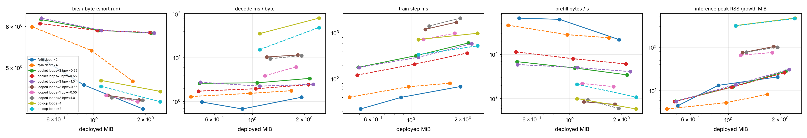

# Scaling sweep

Sizes (MiB deployed): [0.5, 1.0, 2.0]. Short runs: 20 steps x 4 x 128 bytes of Shakespeare, cosine; single-threaded CPU, one process per point. Smoke-scale: read slopes and orderings, not absolute bits per byte.

## Points

| curve | target MiB | width | params | deployed MiB | disk MiB | bpb | train step ms | train CPU util | train peak RSS MiB | decode ms/B | decode CPU ms/B | prefill B/s | infer peak RSS MiB |
|---|---|---|---|---|---|---|---|---|---|---|---|---|---|
| fp16 depth=2 | 0.5 | 96 | 0.27M | 0.51 | 1.03 | 5.181 | 22 | 0.93 | 45 | 0.98 | 0.91 | 65969 | 5 |
| fp16 depth=2 | 1.0 | 128 | 0.46M | 0.87 | 1.76 | 4.632 | 40 | 1.01 | 67 | 0.68 | 0.69 | 61906 | 13 |
| fp16 depth=2 | 2.0 | 192 | 1.01M | 1.93 | 3.87 | 4.164 | 68 | 1.01 | 108 | 1.26 | 1.33 | 21632 | 21 |
| fp16 depth=4 | 0.5 | 64 | 0.23M | 0.44 | 0.90 | 5.990 | 40 | 1.01 | 61 | 1.30 | 1.29 | 45600 | 4 |
| fp16 depth=4 | 1.0 | 96 | 0.51M | 0.97 | 1.96 | 5.393 | 68 | 1.00 | 76 | 1.54 | 1.63 | 27889 | 5 |
| fp16 depth=4 | 2.0 | 128 | 0.88M | 1.68 | 3.39 | 4.708 | 81 | 1.01 | 121 | 1.77 | 1.88 | 23771 | 8 |
| pocket loops=3 bpw=0.55 | 0.5 | 64 | 0.32M | 0.49 | 1.36 | 6.185 | 178 | 1.01 | 101 | 2.61 | 2.74 | 6850 | 6 |
| pocket loops=3 bpw=0.55 | 1.0 | 192 | 1.57M | 1.07 | 6.10 | 5.896 | 320 | 1.00 | 231 | 2.68 | 2.85 | 4934 | 12 |
| pocket loops=3 bpw=0.55 | 2.0 | 320 | 4.16M | 2.15 | 15.98 | 5.827 | 603 | 1.01 | 486 | 3.38 | 3.56 | 3447 | 28 |
| pocket loops=1 bpw=0.55 | 0.5 | 64 | 0.32M | 0.49 | 1.35 | 6.077 | 122 | 1.03 | 84 | 1.73 | 1.76 | 11399 | 6 |
| pocket loops=1 bpw=0.55 | 1.0 | 192 | 1.55M | 1.04 | 6.05 | 5.895 | 208 | 1.01 | 161 | 1.96 | 2.09 | 7990 | 12 |
| pocket loops=1 bpw=0.55 | 2.0 | 320 | 4.14M | 2.12 | 15.90 | 5.843 | 365 | 1.01 | 331 | 2.43 | 2.39 | 6082 | 26 |
| pocket loops=3 bpw=1.0 | 0.5 | 64 | 0.35M | 0.50 | 1.47 | 6.223 | 178 | 1.01 | 102 | 2.77 | 2.95 | 5884 | 6 |
| pocket loops=3 bpw=1.0 | 1.0 | 192 | 1.85M | 1.10 | 7.20 | 5.895 | 296 | 1.00 | 248 | 2.24 | 2.36 | 5033 | 14 |
| pocket loops=3 bpw=1.0 | 2.0 | 320 | 4.93M | 2.25 | 18.95 | 5.827 | 579 | 1.01 | 529 | 2.46 | 2.46 | 4086 | 31 |
| looped loops=3 bpw=0.55 | 1.0 | 256 | 2.52M | 1.21 | 9.70 | 4.422 | 1196 | 1.02 | 795 | 10.44 | 10.83 | 847 | 75 |
| looped loops=3 bpw=0.55 | 2.0 | 320 | 3.99M | 1.83 | 15.31 | 4.332 | 1702 | 1.01 | 1026 | 11.57 | 12.24 | 741 | 103 |
| looped loops=1 bpw=0.55 | 1.0 | 256 | 2.50M | 1.18 | 9.64 | 4.422 | 724 | 1.01 | 465 | 3.89 | 3.95 | 2196 | 66 |
| looped loops=1 bpw=0.55 | 2.0 | 320 | 3.97M | 1.79 | 15.24 | 4.299 | 979 | 1.01 | 637 | 6.18 | 6.47 | 1870 | 75 |
| looped loops=3 bpw=1.0 | 1.0 | 256 | 3.02M | 1.27 | 11.62 | 4.377 | 1400 | 1.01 | 867 | 9.55 | 9.75 | 929 | 77 |
| looped loops=3 bpw=1.0 | 2.0 | 320 | 4.77M | 1.93 | 18.29 | 4.327 | 2088 | 1.02 | 1159 | 11.20 | 11.64 | 599 | 100 |
| oploop loops=4 | 1.0 | 128 | 0.58M | 1.10 | 2.22 | 4.725 | 716 | 1.02 | 343 | 35.72 | 36.18 | 1005 | 313 |
| oploop loops=4 | 2.0 | 192 | 1.27M | 2.43 | 4.88 | 4.501 | 980 | 1.02 | 483 | 80.60 | 82.19 | 583 | 464 |
| oploop loops=2 | 1.0 | 128 | 0.58M | 1.10 | 2.21 | 4.603 | 337 | 1.03 | 231 | 15.41 | 15.89 | 2110 | 310 |
| oploop loops=2 | 2.0 | 192 | 1.27M | 2.43 | 4.87 | 4.300 | 522 | 1.02 | 330 | 49.15 | 50.57 | 1081 | 455 |

## Fits (y = a * MiB^b)

| curve | points | bits / byte (short run) | decode ms / byte | train step ms | prefill bytes / s | inference peak RSS growth MiB |
|---|---|---|---|---|---|---|
| fp16 depth=2 | 3 | b=-0.16 (r2 0.98) | b=+0.23 (r2 0.25) | b=+0.83 (r2 0.98) | b=-0.87 (r2 0.87) | b=+1.10 (r2 0.89) |
| fp16 depth=4 | 3 | b=-0.18 (r2 0.97) | b=+0.23 (r2 1.00) | b=+0.53 (r2 0.97) | b=-0.49 (r2 0.97) | b=+0.56 (r2 0.97) |
| pocket loops=3 bpw=0.55 | 3 | b=-0.04 (r2 0.91) | b=+0.17 (r2 0.81) | b=+0.82 (r2 1.00) | b=-0.47 (r2 1.00) | b=+1.07 (r2 1.00) |
| pocket loops=1 bpw=0.55 | 3 | b=-0.03 (r2 0.92) | b=+0.23 (r2 0.97) | b=+0.75 (r2 1.00) | b=-0.43 (r2 1.00) | b=+1.04 (r2 1.00) |
| pocket loops=3 bpw=1.0 | 3 | b=-0.04 (r2 0.90) | b=-0.08 (r2 0.34) | b=+0.78 (r2 0.99) | b=-0.24 (r2 0.99) | b=+1.12 (r2 1.00) |
| looped loops=3 bpw=0.55 | 2 | b=-0.05 (r2 1.00) | b=+0.25 (r2 1.00) | b=+0.85 (r2 1.00) | b=-0.32 (r2 1.00) | b=+0.76 (r2 1.00) |
| looped loops=1 bpw=0.55 | 2 | b=-0.07 (r2 1.00) | b=+1.10 (r2 1.00) | b=+0.72 (r2 1.00) | b=-0.38 (r2 1.00) | b=+0.33 (r2 1.00) |
| looped loops=3 bpw=1.0 | 2 | b=-0.03 (r2 1.00) | b=+0.38 (r2 1.00) | b=+0.96 (r2 1.00) | b=-1.05 (r2 1.00) | b=+0.63 (r2 1.00) |
| oploop loops=4 | 2 | b=-0.06 (r2 1.00) | b=+1.03 (r2 1.00) | b=+0.40 (r2 1.00) | b=-0.69 (r2 1.00) | b=+0.49 (r2 1.00) |
| oploop loops=2 | 2 | b=-0.09 (r2 1.00) | b=+1.46 (r2 1.00) | b=+0.55 (r2 1.00) | b=-0.84 (r2 1.00) | b=+0.48 (r2 1.00) |

## Crossovers against `fp16 depth=2`

Each cell: the curve / baseline ratio over the curve's measured sizes (baseline read off its fit), then the crossover size if the two fits meet within the measured range (2x margin), else whether it is better or worse at every measured size. For prefill, higher is better; for the rest, lower. Fits from 2 points always have r2 = 1; trust slopes from 3+ points and r2 near 1.

| curve | bits / byte (short run) | decode ms / byte | train step ms | prefill bytes / s | inference peak RSS growth MiB |
|---|---|---|---|---|---|
| fp16 depth=4 | x1.13-1.15; worse everywhere measured | x1.64; worse everywhere measured | x1.34-2.00; worse everywhere measured | x0.51-0.84; crosses at 2.7 MiB, better above | x0.39-0.80; crosses at 0.29 MiB, better above |
| pocket loops=3 bpw=0.55 | x1.19-1.42; worse everywhere measured | x2.87-3.12; worse everywhere measured | x7.65; worse everywhere measured | x0.09-0.16; worse everywhere measured | x1.03-1.08; worse everywhere measured |
| pocket loops=1 bpw=0.55 | x1.17-1.43; worse everywhere measured | x2.11; worse everywhere measured | x4.73-5.33; worse everywhere measured | x0.14-0.27; worse everywhere measured | x0.99-1.08; crosses at 1.7 MiB, better above |
| pocket loops=3 bpw=1.0 | x1.20-1.43; worse everywhere measured | x2.04-3.27; worse everywhere measured | x6.94-7.46; worse everywhere measured | x0.08-0.20; worse everywhere measured | x1.08-1.11; worse everywhere measured |
| looped loops=3 bpw=0.55 | x0.99-1.04; crosses at 1.3 MiB, better below | x10.51; worse everywhere measured | x24.95; worse everywhere measured | x0.02-0.03; worse everywhere measured | x4.66-5.35; worse everywhere measured |
| looped loops=1 bpw=0.55 | x0.99-1.03; crosses at 1.4 MiB, better below | x3.94-5.68; worse everywhere measured | x14.72-15.41; worse everywhere measured | x0.06-0.07; worse everywhere measured | x3.48-4.80; worse everywhere measured |
| looped loops=3 bpw=1.0 | x0.99-1.05; crosses at 1.4 MiB, better below | x9.50-10.12; worse everywhere measured | x28.01-29.60; worse everywhere measured | x0.02-0.03; worse everywhere measured | x4.27-5.19; worse everywhere measured |
| oploop loops=4 | x1.04-1.13; crosses at 0.72 MiB, better below | x36.75-68.98; worse everywhere measured | x11.46-16.11; worse everywhere measured | x0.03-0.03; worse everywhere measured | x15.33-24.71; worse everywhere measured |
| oploop loops=2 | x1.02-1.08; crosses at 0.89 MiB, better below | x15.86-42.07; worse everywhere measured | x6.10-7.60; worse everywhere measured | x0.05-0.06; worse everywhere measured | x15.04-24.48; worse everywhere measured |

